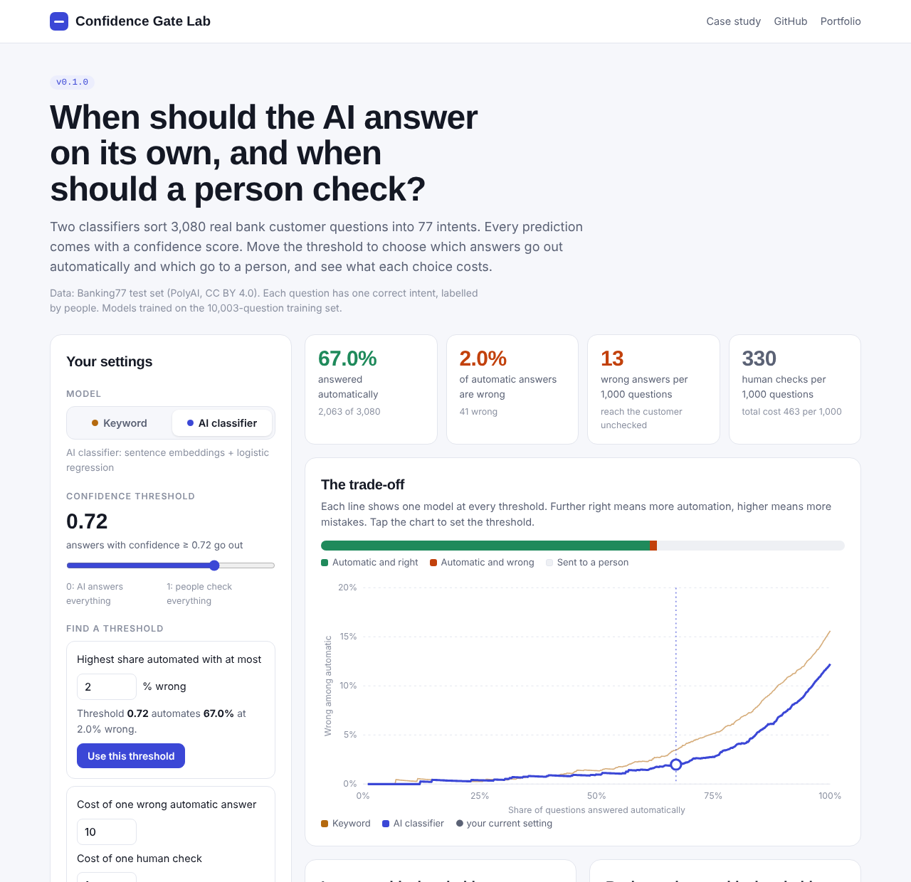

# Confidence Gate Lab

**When should an AI answer on its own, and when should a person check? Explore the trade-off on 3,080 real, labelled bank customer questions.**

**Current version:** 0.1.0

Live demo: https://kostasxeras.com/confidence-gate-lab/



## Why this exists

Every AI feature that talks to customers needs a rule for when it may answer alone. Set the bar too low and wrong answers reach customers. Set it too high and people end up checking almost everything, so the AI saves little. Teams often pick that bar by gut feel, and often reuse it when the model changes.

This lab makes the decision visible. Two classifiers sort bank customer questions into 77 intents, and each prediction comes with a confidence score. You move one threshold and see, for each model, how many questions are answered automatically, how many of those answers are wrong, and how many land on a person's desk.

## What it does

- Compares a keyword baseline with an AI classifier on the same questions.
- Shows the trade-off curve for both models and the current setting on it.
- Finds the threshold that automates the most while staying under an error rate you choose.
- Finds the cheapest threshold for your own cost of a wrong answer and cost of a human check.
- Lists the 77 intents from hardest to easiest at the chosen threshold.
- Shows real questions the customer would get right, get wrong, or have sent to a person.

## Main findings

Full detail in the [case study](docs/case-study.md). All numbers are from the Banking77 test set (3,080 questions).

- At most 2% wrong among automatic answers: the AI classifier answers 67.0% automatically, the keyword baseline 55.1%.
- To stay within 2%, the AI classifier needs a threshold of 0.72 and the keyword baseline 0.96. At 0.72 the keyword model is wrong 6.4% of the time. A threshold does not carry over from one model to another.
- The keyword model is overconfident. Of its answers with confidence 0.9 or more, 3.3% are wrong. For the AI classifier the same figure is 0.8%.

## Data and models

- Data: [Banking77](https://github.com/PolyAI-LDN/task-specific-datasets) by PolyAI, licensed CC BY 4.0. 10,003 training questions and 3,080 test questions, each labelled by people with one of 77 intents.
- Keyword baseline: naive Bayes on word counts.
- AI classifier: sentence embeddings (the small English model from EnergeticAI) with logistic regression on top.
- Both models are trained once, offline. The app only reads their predictions from `data/results.json`, so it needs no server and no API key.

## How it was built

I framed the problem, chose the dataset and the comparisons, and wrote the findings. Claude (Anthropic) was my engineering partner for the code. Decisions are recorded in [docs/decisions](docs/decisions).

## Run it locally

Open `index.html` through any local web server, for example `python3 -m http.server`, then go to http://localhost:8000. To rebuild the data, see [scripts/README.md](scripts/README.md).

## Repo layout

```
index.html              The whole app, one file
data/results.json       Predictions and confidence for every test question
scripts/                How the models were trained and the data exported
docs/product-brief.md   Users, goals, scope
docs/case-study.md      Question, approach, findings, next steps
docs/decisions/         One record per real trade-off
docs/versioning.md      How releases work
```
